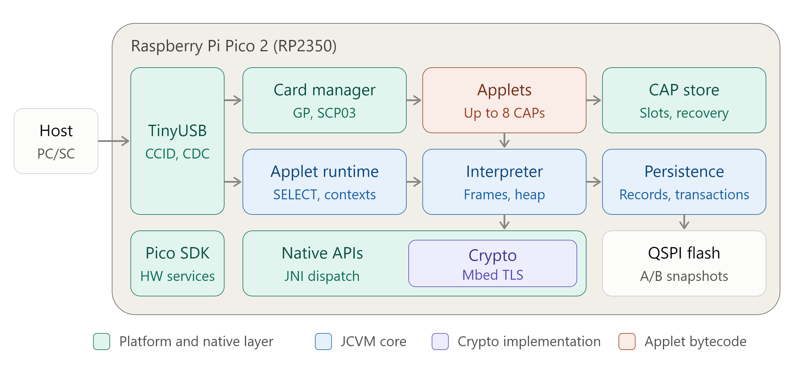

# Pico 2 Java Card VM

## 1. Educational project — read first

> [!WARNING]
> This project is **NOT production-ready. Do not use it for security-critical tasks.** It was almost completely coded by large language models, mostly GPT-6 Sol and Luna.
>
> This is a self-educational attempt to understand how to:
> 1. Perform complex agentic development with real physical hardware.
> 2. Keep agents working effectively day and night using skills, `/goal`, task lists, guardrails, acceptance gates, and repository cleanup.
> 3. Conduct effective functional, performance, and security reviews.
> 4. Give humans insight into what agents implemented over a day, week, or month.
> 5. Understand the architecture of the resulting system.

## 2. What this project does

This project turns a Raspberry Pi Pico 2 into a physical USB token that emulates a smart-card reader with an inserted Java Card. Your operating system sees it as a **PC/SC reader with a card**, accessible through standard smart-card tools.

The firmware implements a functional **Java Card virtual machine** and **GlobalPlatform applet management**. You can upload, install, and use Java Card applets supplied as CAP files, provided they use the supported bytecode and API subset. Applets execute on the Pico itself, with persistent data stored in flash.

The implementation is based on [CHOUPI, an open-source Java Card Virtual Machine](https://github.com/gavz/choupi), extended with Pico 2 hardware support, USB CCID transport, applet management, persistence, and native cryptography.



## 3. Try it

You need a Raspberry Pi Pico 2, a USB data cable, Java, PC/SC support, and these downloads:

- [JCAlgTest CAP files — latest release](https://github.com/crocs-muni/JCAlgTest/releases/latest): the repository acceptance baseline is the supplied **v1.8.5, Java Card Classic 3.0.5 (`jc305`)** CAP, pinned in `tests/fixtures/manifest.json`; run it with the v1.8.5 host client.
- [JCAlgTest PC client — latest release](https://github.com/crocs-muni/JCAlgTest/releases/latest): use client **v1.8.5** (`AlgTestJClient_v1.8.5.jar`, pinned in `tests/fixtures/external/jcalgtest/1.8.5/client/`). Older clients do not send the card-reset/object-deletion APDU correctly, so long runs exhaust card memory.
- [GlobalPlatformPro `gp.jar` binary](https://github.com/martinpaljak/GlobalPlatformPro/releases/latest/download/gp.jar).

1. Download [pico2-jcvm-max_crypto-arm__latest.uf2](https://github.com/mcubench/pico2-jcvm/releases), or build an ARM JCVM **`.uf2`** image below.
2. Hold **BOOTSEL** while connecting the Pico 2. Copy the image onto the **RPI-RP2** drive; the board reboots as a USB smart-card reader. An **empty-card image erases installed applets and persistent data**.
3. Install the unchanged upstream JCAlgTest v1.8.5 applet:

   ```sh
   java -jar gp.jar --reader "<Pico reader name>" \
     --install "<downloaded JC305 CAP file>"
   ```

4. Run the v1.8.5 client and select the Pico reader when prompted:

   ```sh
   java -jar AlgTestJClient_v1.8.5.jar \
     -op ALG_SUPPORT_EXTENDED -fresh -outpath results
   ```

Results are written under `results/`. Unsupported algorithms are expected; a support report does not establish security or full Java Card conformance.

See the [physical test runbook](docs/jcalgtest-physical-runbook.md) and [Windows instructions](docs/windows-asymm-symm-test.md). Agents accessing hardware must follow [AGENTS.md](AGENTS.md).

## 4. Build from source

Build setup is currently manual. Initialize the required submodules and provision the dependencies described in the [toolchain notes](.agent/TOOLCHAIN.md): Pico SDK, ARM toolchain, CMake/Ninja, Rust, Java/Ant/Maven, and Java Card development dependencies.

From the repository root, use the wrappers:

```sh
./tools/doctor
./tools/build arm --profile max_crypto
./tools/package-empty-card-uf2
```

Outputs:

- Firmware: `build/arm/pico2_choupi.uf2`
- Empty-card image: `artifacts/firmware/pico2-jcvm-max_crypto-arm-empty-card-current.uf2`

ARM Cortex-M33 runs the complete JCVM firmware; RISC-V (Hazard3) is out of scope.

## 5. Architecture and development

The Pico 2 runs a native C++ Java Card VM derived from CHOUPI. It interprets installed CAP files and dispatches Java Card APIs and cryptography to native C++ code.

```text
Host application → PC/SC → USB CCID → Card manager / JCRE
                                    → CAP interpreter → Native APIs
                                                      → Flash storage
```

The compatibility target is **Java Card Classic 3.0.5**. Full specification conformance remains unverified.

| Feature | Status | Coverage / limits |
| --- | --- | --- |
| CAP loading and bytecode interpretation |  | Imports must resolve to API packages present in the firmware ROM mask. |
| Applet lifecycle |  | Installation, selection, and deletion. |
| Short APDUs and response chaining |  | Standard short command/response path. |
| Persistent objects in flash |  | CRC-protected flash journal; writes limited to what Java Card atomicity requires (single elements, `Util` block updates, transactions). Power-loss acceptance remains open. |
| Framework APIs |  | `Util`, `OwnerPIN` (try counter durable before comparison, validated flag in RAM), and implemented `JCSystem` transient-memory and transaction operations; complete per-method coverage is not established. |
| Native cryptography |  | Profile-dependent keys, digests, random numbers, ciphers, signatures/MACs, and key agreement. `max_crypto` declares **159 of 162** capability flags enabled, including AES, DES/3DES, RSA, elliptic-curve operations, SHA digests, and HMAC variants; `InitializedMessageDigest` and all five 3.0.5 `OneShot` classes (RAM-only). The default profile is `baseline`; profile flags do not establish full algorithm acceptance. |
| GlobalPlatform card management |  | Tested SCP03 authentication, LOAD/INSTALL, SELECT, DELETE, GET DATA, and GET STATUS flows. A physical regression confirms ordinary applet APDUs remain accessible after GPPro disconnects from SCP03. |
| Cross-applet sharing and firewall |  | Targeted cross-AID sharing, proxy lifecycle, and firewall tests exist. Coordinated cross-context garbage-collection roots/cycles have host-unit coverage; full isolation semantics and device RAM bounds remain unestablished. |
| MessageDigest input |  | At most **2,046 cumulative bytes** across `update()` and `doFinal()`. |
| Extended-length APDUs |  | Not implemented. |
| T=1 waiting-time extension |  | Not implemented. |
| Logical channels |  | Not implemented. |
| Persistent-object reclamation / `JCSystem.requestObjectDeletion()` |  | **Enabled in the normal build** (`mode=normal`; `PICO2_ENABLE_OBJECT_DELETION=0` gives a diagnostic build without it). It queues deletion for service after the APDU unwinds. Power-loss acceptance remains open. |
| Optional packages absent from the ROM mask |  | Imports such as `javacardx.external` are rejected. |
| RSA/RSA-CRT 4096-bit key-pair generation |  | Excluded from `max_crypto`. |

### Supplied Java Card API CAP coverage

The matrix lists all 48 [supplied CAPs](tests/fixtures/external/javacard-api/provided-20261107/caps) by family and version suffix. The 3.0.5 column summarizes historical Pico 2 results across firmware builds. Earlier variants are listed as unverified. See the [progress records](progress.md) for profiles, counts, and emulator results.

| CAP family | 2.2.1 (`221`) | 2.2.2 (`222`) | 3.0.3 (`303`) | 3.0.4 (`304`) | 3.0.5 (`305`) |
| --- | --- | --- | --- | --- | --- |
| Biometry | Unverified | Unverified | Unverified | Unverified | INSTALL refused |
| Core | Unverified | Unverified | Unverified | Unverified | Partial. 272 of 291 cases passed in the recorded `max_crypto` run, with four Ext cases unavailable. |
| Crypto | Unverified | Unverified | Unverified | Unverified | Partial. Native crypto calls passed, with unsupported cases and unexpected errors in full physical sweeps. |
| Ext | — | Unverified | Unverified | Unverified | INSTALL refused. Extended-length APDUs are unsupported. |
| Javacardx | Unverified | Unverified | Unverified | Unverified | INSTALL refused |
| JavacardxExt | — | Unverified | Unverified | Unverified | INSTALL refused |
| JavacardxInt | — | Unverified | Unverified | Unverified | INSTALL refused |
| JavacardxSec | — | — | — | — | 84 of 84 cases passed on a tested build. |
| Multi | Unverified | Unverified | Unverified | Unverified | Two applet instances installed for the Core scenarios. Full scenario coverage remains unverified. |
| Security | Unverified | Unverified | Unverified | Unverified | Partial. Key API calls passed, with unsupported cases and resource failures in physical sweeps. |
| Service | Unverified | Unverified | Unverified | Unverified | 124 of 124 cases passed on a tested build. |

A dash indicates that the suite supplied no CAP for that version.

- [Architecture and layering](docs/FIRMWARE_JCVM_ARCHITECTURE.md)
- [Supported API profile](docs/supported-profile.md)
- [Persistence and filesystem](docs/FILESYSTEM_ABI.md)
- [Active tasks](TODO.md), [progress](progress.md), and [agent handoff](.agent/HANDOFF.md)

## Test organization

See [tests/README.md](tests/README.md) for unit/integration/hardware tests and immutable external fixtures. Verify supplied inputs with `./tools/fixture-path --verify`. JCAlgTest (1.8.5 CAP, 1.8.5 client) and the independent API CAP suite have separate pinned clients; historical 1.8.2 evidence is not current acceptance.
