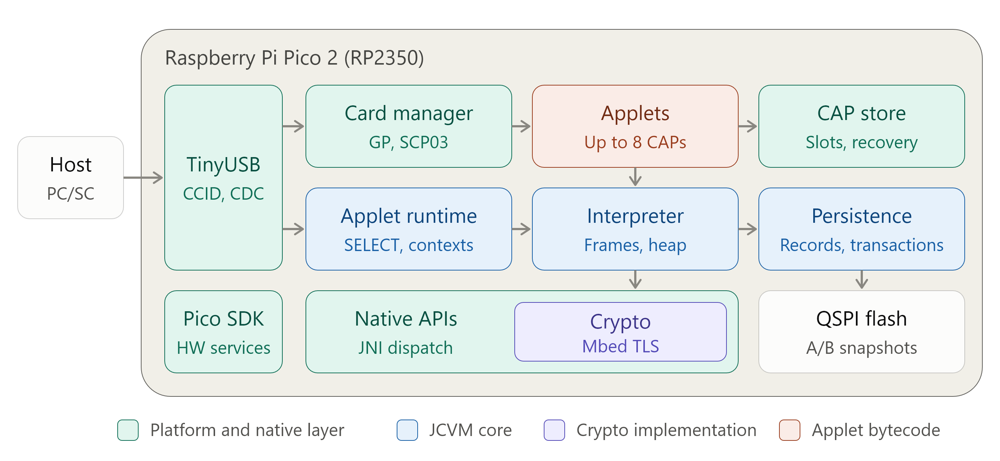

# Pico 2 Java Card VM

## 1. Educational project — read first

> [!WARNING]
> This project is **NOT production-ready. Do not use it for security-critical tasks.** It was almost completely coded by large language models, mostly GPT-6 Sol and Luna.
>
> This is a self-educational attempt to understand how to:
> 1. Perform complex agentic development with real physical hardware.
> 2. Keep agents working effectively day and night using skills, `/goal`, task lists, guardrails, acceptance gates, and repository cleanup.
> 3. Conduct effective functional, performance, and security reviews.
> 4. Give humans insight into what agents implemented over a day, week, or month.
> 5. Understand the architecture of the resulting system.

## 2. What this project does

This project turns a Raspberry Pi Pico 2 into a physical USB token that emulates a smart-card reader with an inserted Java Card. Your operating system sees it as a **PC/SC reader with a card**, accessible through standard smart-card tools.

The firmware implements a functional **Java Card virtual machine** and **GlobalPlatform applet management**. You can upload, install, and use Java Card applets supplied as CAP files, provided they use the supported bytecode and API subset. Applets execute on the Pico itself, with persistent data stored in flash.

The implementation is based on [CHOUPI, an open-source Java Card Virtual Machine](https://github.com/gavz/choupi), extended with Pico 2 hardware support, USB CCID transport, applet management, persistence, and native cryptography.



## 3. Try it

You need a Raspberry Pi Pico 2, a USB data cable, Java, PC/SC support, and these downloads:

- [JCAlgTest CAP files — latest release](https://github.com/crocs-muni/JCAlgTest/releases/latest): the repository acceptance baseline is the supplied **v1.8.4, Java Card Classic 3.0.5 (`jc305`)** CAP, pinned with its matching client in `tests/fixtures/manifest.json`.
- [JCAlgTest PC client — latest release](https://github.com/crocs-muni/JCAlgTest/releases/latest): extract `AlgTestJClient.jar` from the same distribution to match the applet.
- [GlobalPlatformPro `gp.jar` binary](https://github.com/martinpaljak/GlobalPlatformPro/releases/latest/download/gp.jar).

1. Download [pico2-jcvm-max_crypto-arm__latest.uf2](https://github.com/mcubench/pico2-jcvm/releases), or build an ARM JCVM **`.uf2`** image below.
2. Hold **BOOTSEL** while connecting the Pico 2. Copy the image onto the **RPI-RP2** drive; the board reboots as a USB smart-card reader. An **empty-card image erases installed applets and persistent data**.
3. Install the unchanged upstream JCAlgTest v1.8.4 applet:

   ```sh
   java -jar gp.jar --reader "<Pico reader name>" \
     --install "<downloaded JC305 CAP file>"
   ```

4. Run the matching client and select the Pico reader when prompted:

   ```sh
   java -jar AlgTestJClient.jar \
     -op ALG_SUPPORT_EXTENDED -fresh -outpath results
   ```

Results are written under `results/`. Unsupported algorithms are expected; a support report does not establish security or full Java Card conformance.

See the [physical test runbook](docs/jcalgtest-physical-runbook.md) and [Windows instructions](docs/windows-asymm-symm-test.md). Agents accessing hardware must follow [AGENTS.md](AGENTS.md).

## 4. Build from source

Build setup is currently manual. Initialize the required submodules and provision the dependencies described in the [toolchain notes](.agent/TOOLCHAIN.md): Pico SDK, ARM and RISC-V toolchains, CMake/Ninja, Rust, Java/Ant/Maven, and Java Card development dependencies.

From the repository root, use the wrappers:

```sh
./tools/doctor
./tools/build arm --profile max_crypto
./tools/build riscv --profile max_crypto
./tools/package-empty-card-uf2
```

Outputs:

- Firmware: `build/arm/pico2_choupi.uf2`
- Empty-card image: `artifacts/firmware/pico2-jcvm-max_crypto-arm-empty-card-current.uf2`

ARM Cortex-M33 runs the complete JCVM firmware. RISC-V currently provides a shared-code build check and smoke image. Build both architectures before flashing.

## 5. Architecture and development

The Pico 2 runs a native C++ Java Card VM derived from CHOUPI. It interprets installed CAP files; Java Card API behavior and cryptography are implemented through native dispatch.

```text
Host application → PC/SC → USB CCID → Card manager / JCRE
                                    → CAP interpreter → Native APIs
                                                      → Flash storage
```

The compatibility target is **Java Card Classic 3.0.5**, with the following coverage and limits:

| Feature | Status | Coverage / limits |
| --- | --- | --- |
| CAP loading and bytecode interpretation |  | Imports must resolve to API packages present in the firmware ROM mask. |
| Applet lifecycle |  | Installation, selection, and deletion. |
| Short APDUs and response chaining |  | Standard short command/response path. |
| Persistent objects in flash |  | Implemented; storage exhaustion remains an issue in long runs. |
| Framework APIs |  | `Util`, PIN handling, and implemented `JCSystem` transient-memory and transaction operations; complete per-method coverage is not established. |
| Native cryptography |  | Profile-dependent keys, digests, random numbers, ciphers, signatures/MACs, and key agreement. `max_crypto` enables AES, DES/3DES, RSA, elliptic-curve operations, SHA digests, and HMAC variants. |
| GlobalPlatform card management |  | Tested SCP03 authentication, LOAD/INSTALL, SELECT, DELETE, GET DATA, and GET STATUS flows. |
| Cross-applet sharing and firewall |  | Targeted tests exist; full isolation semantics are not established. |
| MessageDigest input |  | At most **2,046 cumulative bytes** across `update()` and `doFinal()`. |
| Extended-length APDUs |  | Not implemented. |
| T=1 waiting-time extension |  | Not implemented. |
| Logical channels |  | Not implemented. |
| Persistent-object reclamation |  | Disabled; `JCSystem.requestObjectDeletion()` is unsupported. |
| Optional packages absent from the ROM mask |  | Imports such as `javacardx.external` are rejected. |
| RSA/RSA-CRT 4096-bit key-pair generation |  | Excluded from `max_crypto`. |

Supported marks the listed implemented path, not full specification conformance. Exact cryptographic capability flags are in [the profile configuration](config/javacard-support.json); these declarations do not prove that every API method or workload passes.

Full specification conformance and complete per-method coverage are not established. JCAlgTest **1.8.4 / jc305** is the acceptance baseline; full acceptance remains open, including persistent-storage exhaustion in long runs. See the [supported profile](docs/supported-profile.md) and [progress records](progress.md) for detailed limits and validation evidence. A host emulator supports development without physical hardware; emulator results and physical Pico 2 results are recorded separately.

- [Architecture and layering](docs/FIRMWARE_JCVM_ARCHITECTURE.md)
- [Supported API profile](docs/supported-profile.md)
- [Persistence and filesystem](docs/FILESYSTEM_ABI.md)
- [Active tasks](TODO.md), [progress](progress.md), and [agent handoff](.agent/HANDOFF.md)

## Test organization

See [tests/README.md](tests/README.md) for unit/integration/hardware tests and immutable external fixtures. Verify supplied inputs with `./tools/fixture-path --verify`. JCAlgTest 1.8.4 and the independent API CAP suite have separate pinned clients; historical 1.8.2 evidence is not current acceptance.
