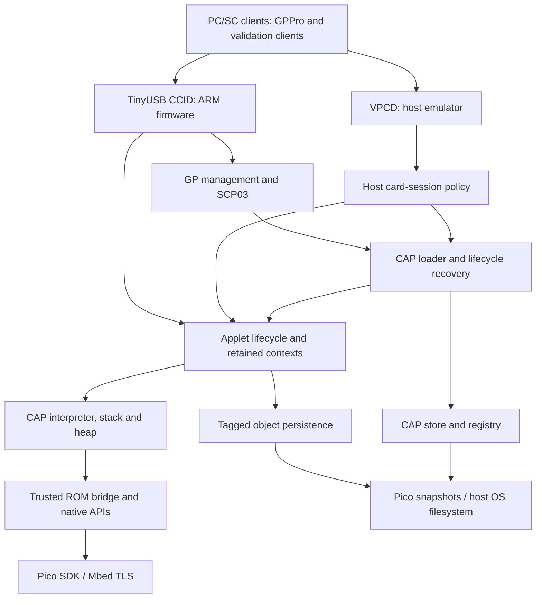

### 1. Executive Summary

Pico2-JCVM turns a Raspberry Pi Pico 2 into a USB CCID reader containing an emulated Java Card. Its native C++ runtime interprets installed CAP bytecode, implements a selected Java Card API surface, manages applets through GlobalPlatform commands, and persists objects in flash. It is a synchronous embedded monolith with identifiable interpreter, runtime, API, management, storage, and platform responsibilities, but these are not independently enforced modules. Its strongest choices are explicit uploaded-code restrictions, recoverable storage publication, and host-based integration testing. Principal risks are incomplete bytecode verification, distributed lifecycle/session ownership, and differences between host and hardware durability. ARM has the full firmware target; RISC-V currently provides VM-core compilation and a smoke executable. This review describes the working tree inspected on 7 November 2026, including pre-existing uncommitted changes; it establishes architecture, not fresh hardware acceptance or complete Java Card conformance.

### 2. Architecture Overview

**Style and technologies.** A layered embedded monolith, implemented primarily in C++17 with C/assembly platform integration. Pico SDK supplies startup, flash, watchdog, entropy, and SHA-256 facilities; TinyUSB supplies composite CDC diagnostics and CCID transport. Mbed TLS primitives support native cryptography. CMake and repository shell/Python wrappers generate capability metadata and build images. The PC executable additionally uses the CHOUPI Rust OS filesystem and a TCP VPCD interface (`CMakeLists.txt`, `choupi/CMakeLists.txt`, `tools/build`).

**Layers.** Host clients send APDUs through PC/SC. Transport and card management route them to runtime lifecycle functions; contexts, stacks, heaps, and CAP handlers support interpretation; trusted framework calls bridge into native APIs. Tagged persistence records sit above platform-specific storage. These are conceptual layers: direct includes, globals, and C ABI calls cross them.

### 3. Logical Components

Paths below are repository-relative; cited symbols identify architectural anchors.

| Component | Responsibility | Key Dependencies | Important Implementation |
|---|---|---|---|
| Platform and transport | Boot, watchdog, USB descriptors/framing, response retries, time extensions | Pico SDK, TinyUSB, lifecycle ABI | `src/choupi_pico2.cpp:main_arm`, `src/ccid_device.cpp:process_message`, `src/ccid_progress_flow.hpp` |
| Card management | SCP03 authentication, LOAD/INSTALL/DELETE, package and instance publication/recovery | CAP parser, registry, persistence | `src/scp03.cpp`, `src/cap_load.cpp:CapLoadSession`, `src/gp_lifecycle_recovery.cpp`, `src/gp_delete.hpp` |
| Runtime/JCRE responsibilities | Selection, restoration, APDU state, retained applet contexts, reset and deletion cleanup | Interpreter, heap, persistent roots | `choupi/src/main.cpp`, `choupi/src/context.cpp`, `src/vm_lifecycle.h` |
| Execution engine and linkage | Decode bytecode, manage frames/references, resolve CAP classes/imports/methods | CAP metadata, contexts, exception machinery | `choupi/src/interpretor.cpp:Interpretor::run`, `choupi/src/jc_bytecodes/`, `choupi/src/jc_handlers/`, `choupi/src/frame.cpp` |
| Java Card APIs and crypto | Checked API marshalling, algorithm/object state, native cryptographic operations | ROM metadata, VM arrays, Pico/Mbed TLS | `choupi/src/jni.cpp`, `choupi/src/native_*.cpp`, `choupi/src/jc_bytecodes/bc_others.cpp:bc_impdep1` |
| Persistent object/storage services | Serialize fields/arrays, rollback, snapshots, CAP slot metadata | Filesystem ABI, flash-safe operations | `choupi/src/jc_handlers/flashmemory.cpp:FlashMemory_Handler`, `src/pico_filesystem.cpp`, `src/cap_store.cpp`, `src/flash_layout.hpp` |
| Host and validation tooling | Emulate card transport/storage, generate ROM assets, select features, run acceptance clients | Rust OS, Java SDK tooling, fixture manifest | `choupi/src/main_pc.cpp`, `choupi/src/vpcd_session.cpp`, `tools/build-pc`, `tools/javacard-support.py`, `tests/README.md` |

### 4. Key Execution Flows

1. **Boot and recovery.** Firmware `main()` delegates to `main_arm()`. It initializes LED/USB diagnostics, captures retained watchdog evidence, calls `fs_init()`, enables the watchdog, and runs the configured framework entry through `runtime()`. Filesystem initialization selects valid generation/CRC snapshots and preserves suspect storage rather than silently initializing over existing data. The main loop services USB, CCID, LED, and diagnostics. Lifecycle reconciliation also runs before relevant loader/restore operations, not solely at boot (`src/choupi_pico2.cpp`, `src/pico_filesystem.cpp:fs_init`, `src/cap_load.cpp:recover_pending_lifecycle_state`). Repeated runtime PASS output reports captured startup status, not a new APDU test.

2. **Provisioning an applet.** A CCID transfer reaches `process_message`; route classification and SCP03 checks distinguish protected manager commands from applet traffic. LOAD assembles and validates CAP components, allocates a dynamic package slot, and publishes package state. INSTALL resolves imports/classes, initializes static state, invokes the CAP installation method, checks registration, and publishes the instance. A committed installation journal supports recovery across publication stages. DELETE coordinates registry removal, persistent namespace cleanup, and runtime invalidation. Errors become APDU status words; recovery reconciles CAP presence, enabled bits, and instance roots (`src/cap_load.cpp`, `src/gp_lifecycle_recovery.cpp`, `src/gp_delete.hpp`).

3. **SELECT and process.** An applet SELECT resolves an instance AID, restores or reuses its retained context, invokes selection behavior, and delivers the selecting APDU. Subsequent commands call `choupi_vm_process_applet`. `Interpretor::run` fetches bounded instructions, dispatches bytecode handlers, and executes nested calls using frames and owner-aware references. ISO exceptions carry status words; other uncaught failures unwind to the entry depth and produce error status. Response chaining is runtime state; CCID retains/retries transport responses. Selection and pending-response globals are centralized in `choupi/src/main.cpp`, while routing policy remains transport-specific.

4. **Native API execution during long work.** Trusted ROM bytecode uses `impdep1` to enter generated JNI dispatch and native API implementations. Uploaded packages cannot use that instruction. Native crypto marshals VM objects into backend operations. Pico interpreter progress runs every 4,096 instructions; native callbacks also service USB/watchdog and time extensions without recursively dispatching another APDU. Nested interpreter entries share an immutable 600-second applet budget; INSTALL uses five seconds. Budget expiry returns `6400`; a stalled path without progress can trigger the watchdog (`choupi/src/interpretor.cpp`, `choupi/src/execution_budget.*`, `src/native_progress_guard.hpp`). These are cooperative synchronous operations, not background workers.

5. **Persistent mutation and transaction completion.** Fields and arrays map to tagged records; stable array identities preserve aliases. Pico writes update a bounded RAM overlay. `FlashMemory_Handler` records transaction before-images and commit-capacity usage; commit clears deferral and syncs an alternate snapshot, while abort restores records. During an active transaction, Pico `fs_sync()` deliberately returns success without flushing. Host record writes instead update emulated flash; `--save` later checkpoints an image and registry sidecar. Host restart tests therefore do not demonstrate physical power-cut durability (`docs/FILESYSTEM_ABI.md`, `choupi/src/jc_handlers/flashmemory.cpp`, `choupi/src/main_pc.cpp`).

### 5. Key Design & Implementation Decisions

Rationale marked **inferred** is architectural interpretation, not a recorded author statement. Alternatives describe the relevant trade-off rather than prescribe a redesign.

| Decision | Rationale | Trade-offs | Evidence |
|---|---|---|---|
| Interpret CAPs; implement algorithms in native C++ | **Documented:** repository runtime boundary assigns API/crypto behavior to native code | Reuses Java Card applets and hardware primitives; requires careful ABI/token mapping. Alternative: interpreted providers, excluded by project policy | `AGENTS.md`, `choupi/src/jni.cpp`, `choupi/src/native_cipher.cpp` |
| Generate trusted ROM assets and select features at build time | **Inferred:** reconcile API compatibility with firmware size constraints | Removes unused algorithms, but couples firmware builds to host generation/profile outputs. Alternative: independent metadata-generation target | `tools/build`, `tools/build-pc`, `config/javacard-support.json`, `CMakeLists.txt` |
| Keep TinyUSB endpoint work on one execution context | **Documented:** avoid racing SDK IRQ background work with endpoint ownership | Simpler state ownership; long operations must cooperate. Alternative: dedicated USB task with explicit queues | `CMakeLists.txt:PICO_STDIO_USB_ENABLE_IRQ_BACKGROUND_TASK`, `src/choupi_pico2.cpp:main_arm` |
| Separate installer authentication from bytecode trust | **Documented:** authenticated CAPs remain untrusted; executing package controls native permission | Blocks direct internal-native dispatch; incomplete type/linkage verification still limits isolation. Alternative: complete pre-execution verifier | `docs/CAP_EXECUTION_TRUST_MODEL.md`, `src/cap_execution_policy.hpp`, `choupi/src/jc_bytecodes/bc_others.cpp` |
| Fixed CAP slots plus alternating filesystem snapshots | **Documented:** preserve prior committed generations and legacy extents | Predictable recovery and bounded allocation; eight dynamic packages and a 1 MiB firmware ceiling constrain growth. Alternative: shared log-structured allocation | `src/flash_layout.hpp`, `src/cap_store.cpp`, `src/pico_filesystem.cpp:persist_overlay` |
| Coordinate separate stores with journals and reconciliation | **Inferred:** CAP headers and object snapshots cannot publish atomically together | Repairs supported interrupted states; recovery rules span several modules. Alternative: single transactional publication store | `src/cap_load.cpp:recover_pending_install_journals`, `src/gp_lifecycle_recovery.cpp`; history `0914836e` |
| Retain inactive applet contexts with owner-aware references | **Documented:** preserve transient state across deselection | Supports cross-applet references/SIO; makes reset, deletion, owner reuse, and GC interdependent. Alternative: shared heap with explicit context partitions | `choupi/src/main.cpp:inactive_applet_contexts`, `choupi/src/context_registry.hpp`, `choupi/src/heap.cpp` |
| Share engine code across host and Pico, retain backend-specific sessions/storage | **Inferred:** enable rapid offline testing while integrating physical hardware | Broad functional testing; transport policy and durability differ. Alternative: one session service over interchangeable transport/storage adapters | `choupi/src/main_pc.cpp`, `choupi/src/vpcd_session.cpp`, `src/ccid_device.cpp`, `docs/FILESYSTEM_ABI.md` |

### 6. Architectural Strengths & Risks

**Strengths**

- Explicit trust rules are executable: native-opcode restrictions, method-body limits, and branch-target checks provide defense beyond CAP structural parsing (`docs/CAP_EXECUTION_TRUST_MODEL.md`).
- Persistence addresses publication failures rather than only steady-state serialization: mirrored metadata, snapshots, journals, and lifecycle reconciliation have distinct responsibilities (`src/cap_store.cpp`, `src/gp_lifecycle_recovery.cpp`).
- Hardware-independent testing covers parser, transactions, ownership, and VPCD integration. Immutable versioned fixtures distinguish JCAlgTest 1.8.4 from historical evidence, improving reproducibility (`tests/README.md`, `tests/fixtures/manifest.json`).
- Execution budgets distinguish hard deadlines from progress servicing, preventing nested work from indefinitely renewing its allowance (`choupi/src/execution_budget.*`).

**Risks and consequences**

- **Incomplete containment:** nested linkage and heap access validation remain incomplete; no per-applet native address-space boundary is established. Extending APIs increases the verifier and marshalling obligations. README explicitly describes an educational, non-production system.
- **Distributed policy ownership:** CCID combines transport, authentication, management, and selection; `main.cpp` owns substantial global lifecycle state; host orchestration differs. Reset/deletion changes require coordinated edits and tests across paths.
- **Persistence layering inversion:** Pico `fs_sync()` queries VM transaction state. A low-level success does not necessarily mean durability, complicating independent reuse and error reasoning (`src/pico_filesystem.cpp:fs_sync`).
- **Capacity and compatibility ceilings:** fixed storage windows bound package growth; MessageDigest buffers at most 2,046 cumulative input bytes (`choupi/src/native_message_digest.cpp`). Extended APDUs/logical channels remain limited (`docs/supported-profile.md`). These constrain workload scale and compatibility, beyond raw CPU throughput.
- **Unequal acceptance scope:** root CMake creates full firmware only for ARM; RISC-V compilation is not runtime parity. Host image/sidecar checkpointing is not atomic or explicitly fsynced. Current handoff records incomplete physical acceptance and an unfinished 1.8.4 sweep; older passes cannot establish today's conformance.

### 7. Open Questions

1. What complete verifier/firewall contract must uploaded CAPs satisfy before hostile-code execution is considered supported?
2. Which physical power-interruption cut points have been exercised across CAP metadata, installation journals, and object snapshots on the current implementation?
3. Is full RISC-V runtime parity intended, given the ARM-only firmware target and older plan scope?
4. What is the intended compatibility target beyond feature flags: specific applets, a defined Java Card subset, or full specification conformance?
5. What measured flash endurance, worst-case snapshot latency, and concurrent retained-context memory limits define sustainable workloads?
